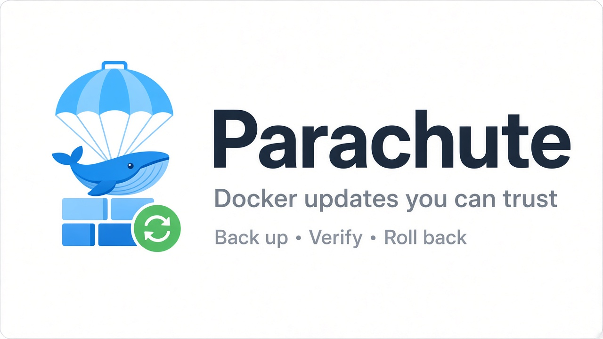
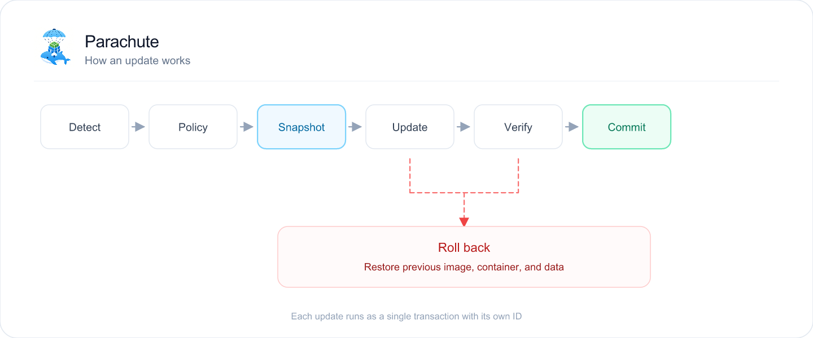

<h1 align="center">Parachute</h1>

<p align="center">
  
</p>

<p align="center">
  <a href="https://github.com/KazzyAPI/parachute/actions/workflows/ci.yml"></a>
</p>

Keeping containers up to date matters, and blind auto-updates break things. Parachute updates your containers the way a careful operator would: it pulls the new image, snapshots your data first, checks that the new version really works, and puts the old one back if it doesn't.

It is one small static binary with no database and nothing to install on your hosts.

## Why you can leave it running

- **Your data is backed up before every update.** Volumes and bind mounts are snapshotted first. Databases are dumped or stopped so the copy is consistent.
- **A bad update undoes itself.** Parachute waits for the new container to be healthy. If it isn't, the previous image, container and data are put back, and you get told why.
- **It does nothing until you say so.** It starts in report-only mode and tells you what it *would* update. New releases wait two days, and database updates need your approval.
- **Your stacks stay in one piece.** A Compose project is updated as a unit, in dependency order, so a web app never meets a half-updated database.
- **You get one calm message, not a flood.** A single digest per cycle through Discord, Slack, Telegram, email, ntfy and more. Secrets are never logged or sent.
- **You know exactly what ran.** An update pulls the digest you approved, never a tag that may have moved since.
- **One instance covers many hosts.** Point it at several Docker hosts over TLS.

## How an update works

<p align="center">
  <picture>
    <source srcset="docs/assets/update-flow.svg" type="image/svg+xml">
    
  </picture>
</p>

The previous container and image are kept until the new version has been verified. If a rollback itself fails, Parachute freezes that stack and tells you, instead of retrying blindly.

## Try it

Build the image and ask Parachute what it would update. Nothing is touched:

```bash
git clone https://github.com/KazzyAPI/parachute.git
cd parachute
make image
docker run --rm \
  -v /var/run/docker.sock:/var/run/docker.sock \
  -v parachute-state:/var/lib/parachute \
  parachute:dev --run-once
```

You get a list of containers with a newer image available. When the list looks right, run it for real:

```bash
docker run -d --name parachute --restart unless-stopped \
  -v /var/run/docker.sock:/var/run/docker.sock \
  -v parachute-state:/var/lib/parachute \
  parachute:dev --armed
```

It checks once a day by default. Set `PARACHUTE_SCHEDULE` for a cron schedule, or `--interval` for a different period.

> Access to the Docker socket is root-equivalent on the host. [ADR-0010](docs/adr/0010-docker-socket-access-and-security.md) explains how Parachute limits what it does with it.

## Tune it with labels

Put labels on a container to change how Parachute treats it.

| Label | Effect |
|---|---|
| `parachute.enable=false` | Leave this container alone. |
| `parachute.monitor-only=true` | Report new versions but never update. |
| `parachute.backup=stop` / `live` / `none` | Choose how its data is snapshotted. |
| `parachute.depends-on=db,cache` | Update and restart in dependency order. |
| `parachute.stop-signal=SIGHUP` | Stop it with the signal it expects. |
| `parachute.lifecycle.pre-update` and friends | Run a command before or after an update (enable with `--enable-lifecycle-hooks`). |

Every setting and label is listed in the [configuration reference](docs/specs/16-configuration.md).

## Coming from another updater?

The [migration guide](docs/migration.md) maps settings, labels and metrics, and explains what behaves differently on day one.

## Built to be trusted

- **Specified first.** The behaviour is written down as specs with acceptance criteria and architecture decisions. Start at [`docs/specs/`](docs/specs/) and [`docs/adr/`](docs/adr/).
- **Tested like a user would.** End-to-end tests run the real binary against real Docker and a local registry.
- **Cautious by default.** When in doubt, Parachute does nothing and tells you why.
- **Small.** One binary, one JSON state file, no database, no agent on your hosts.

## Contributing

Read [`CONTRIBUTING.md`](CONTRIBUTING.md) for the workflow and commit standard. A change in behaviour starts as a change to a spec.

## License

Licence terms will be published with the first release.
